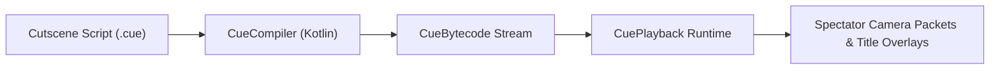

# 🎬 CueScript: Cutscene & Camera Sequence DSL

> **Bytecode-Compiled Cinematic Camera Paths, Dialogue Sequences, and Cutscene Playback Engine.**  
> *Hard-proof documentation for `libs/cuescript`.*

---

## ⚡ 1. Overview & Architecture

`cuescript` is a specialized cinematic scripting engine written in Kotlin. It parses declarative camera path scripts into compact bytecode that runs deterministic player cutscenes with interpolation smoothing.



---

## 📋 2. Verified Cutscene Script Example (`intro.cue`)

```cuescript
# Introduction Cutscene
KEYFRAME 0s   POS 100.5 64.0 -200.5 ROT 0.0 0.0
KEYFRAME 3s   POS 120.0 80.0 -180.0 ROT 45.0 -15.0 INTERP CUBIC
TITLE 1s "§6§lWELCOME TO TERRORIFY" "§7Prepare for battle"
SOUND 2s "entity.ender_dragon.growl" 1.0 1.0
KEYFRAME 6s   POS 104.5 64.0 -212.3 ROT 90.0 0.0 INTERP LINEAR
FINISH 7s
```

---

## 📖 Canonical Specifications
* **[`.bible/09-shared-libraries-and-apis`](.bible/09-shared-libraries-and-apis)**
